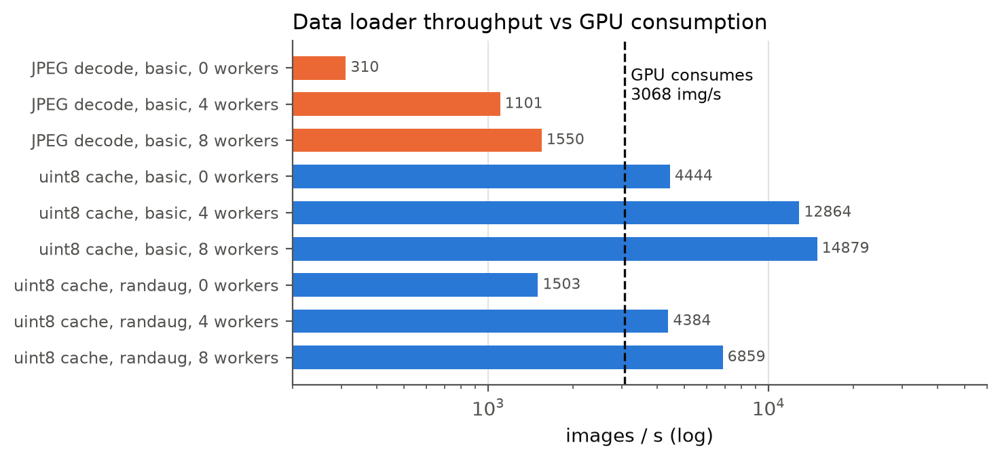
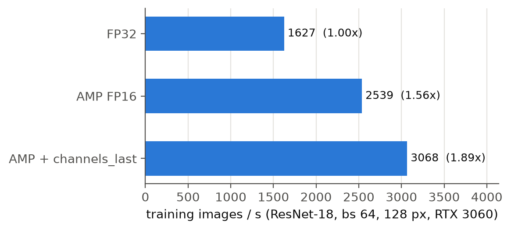
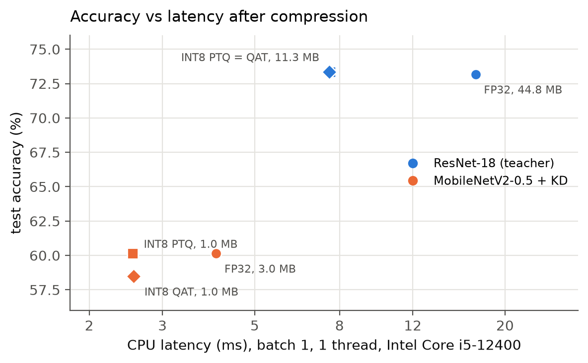
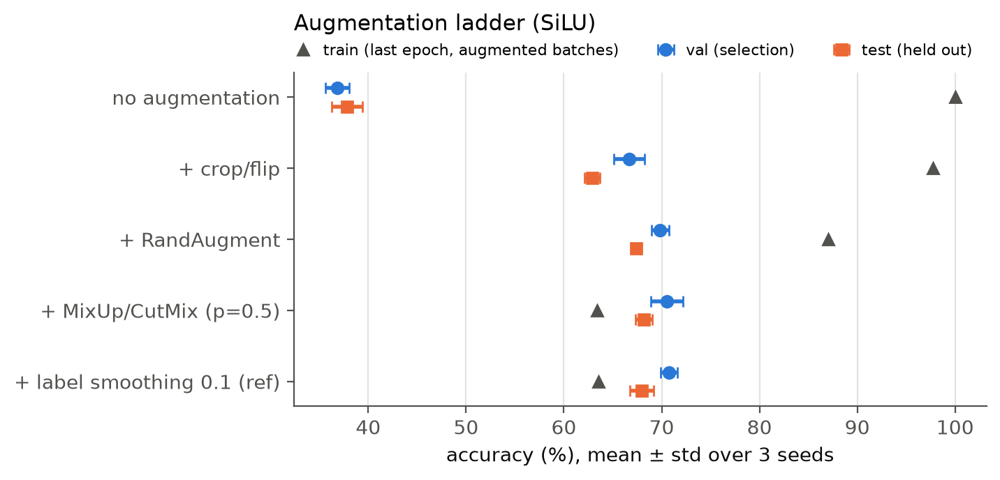
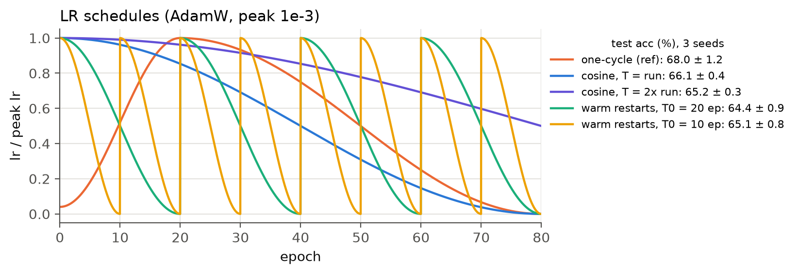
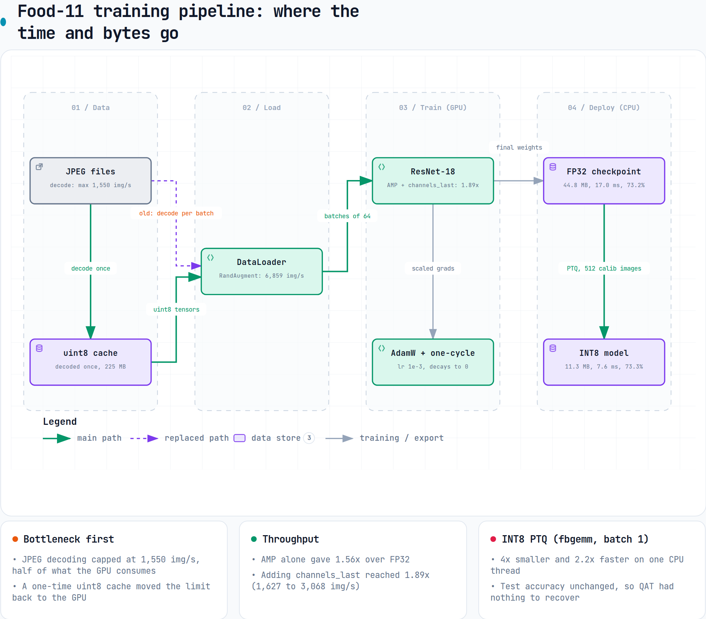
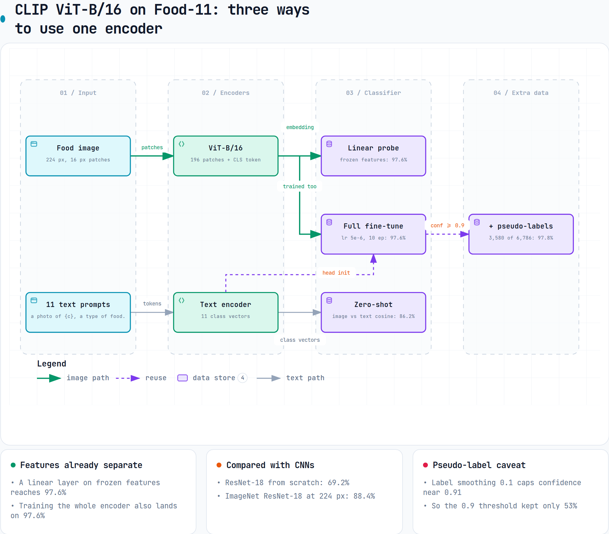

# Food-11 CNN training pipeline

An ablation study of the parts of a CNN training pipeline, run on the Food-11 dataset from Hung-yi Lee's ML 2021 HW3. Every model is trained **from scratch**, as the homework requires, on a single RTX 3060. A separate section then measures how far pretrained backbones go.

Full report (in Chinese): [`report/report.md`](report/report.md). Raw results are in `runs/`.

| Topic | Result (test set) |
|---|---|
| Data loader | Decoding JPEGs every batch saturates at 1,550 img/s, while the GPU consumes 3,068 img/s. A uint8 decode cache removes the bottleneck. |
| AMP + channels-last | 1.89× training throughput over FP32. |
| Augmentation ladder (3 seeds) | 37.7% → 69.2% (crop/flip +24.7, RandAugment +4.8; MixUp/CutMix and label smoothing within noise). |
| INT8 PTQ, ResNet-18 | 44.8 → 11.3 MB; 1-thread CPU latency 17.0 → 7.6 ms; accuracy unchanged (73.2 → 73.3). |
| Optuna (TPE + median pruning) | Did **not** beat the hand-picked setting (67.8 vs 69.2). The 440-image validation set is too small to rank close configurations. |
| One-factor-at-a-time study (ResNet-18 + SiLU, 3 seeds) | Momentum 0 → 0.9: +5.7 pt (SGD). One-cycle (warmup + cosine annealing, with β1 cycling) beats plain cosine by 1.9 pt and warm restarts by 3–4 pt. Dropout, an MLP head and L2 strength stay within noise; L1 1e-4 costs 4.8 pt. |
| Knowledge distillation | Small, consistent gain (+1.4 / +2.0 pt). |
| Pretrained backbones (outside the homework rules) | ImageNet ResNet-18: 84.3% at 128 px, 88.4% at 224 px. CLIP ViT-B/16: zero-shot 86.2%, linear probe 97.6%, full fine-tune 97.6%, plus pseudo-labels 97.8 ± 0.3 (within noise). |

Sections before the SiLU study use ReLU (the INT8 model needs ReLU for fbgemm fusion). Also covered: LR sweep, schedulers (constant, step, cosine, warmup, one-cycle), QAT and TTA.

## Figures



Throughput of each DataLoader setting; the vertical line is what the GPU consumes. Decoding JPEGs every batch tops
out at 1,550 img/s, half of the GPU's 3,068 img/s. A uint8 cache decoded once reaches 6,859 img/s and moves the
bottleneck back to the GPU; only then do AMP and channels-last pay off.



AMP plus channels-last trains ResNet-18 at 1.89× FP32 throughput.



Accuracy vs single-thread CPU latency. Conv/BN/ReLU fusion, calibration on 512 training images, then INT8
post-training quantization (x86 / fbgemm): 44.8 → 11.3 MB, 17.0 → 7.6 ms, test accuracy 73.2% → 73.3%.
Quantization-aware training did no better.



Augmentation added one at a time (ResNet-18 + SiLU, 3 seeds). Without it the model memorizes the 2,640 training
images (train 100%, test 37.8%). Crop/flip and RandAugment account for almost all of the gain; MixUp/CutMix and label
smoothing stay within the seed spread of about 1 point.



LR schedules compared in the one-factor study: one-cycle warms up and then anneals to near zero; cosine with
T = 2× the run anneals only halfway; warm restarts reset the lr every T0 epochs.

## Diagrams

Annotated with the numbers measured in this repo. Interactive HTML versions are in [`docs/diagrams/`](docs/diagrams/).





```bash
uv sync
uv run python scripts/profile_pipeline.py
uv run python scripts/experiments.py            # default stages; or name stages, e.g. aug quant hparams
uv run python scripts/transfer.py               # pretrained backbones: clip sweep seeds pseudo
uv run python scripts/make_figs.py
```
