# Food-11：從訓練到 INT8 部署的對照實驗

資料：李宏毅 ML2021 HW3 的 Food-11（11 類）。ResNet-18 與 MobileNetV2-0.5 都從零開始訓練（不使用 pretrained weights，與作業規定一致）。第 8 節是作業規定以外的追加實驗，改用預訓練模型。
硬體：RTX 3060 12 GB、Intel Core i5-12400、WSL2。軟體：PyTorch 2.7.1+cu128、torchvision 0.22.1，以 uv 管理。

## 0. 實驗規則

| split | 張數 | 來源 | 用途 |
|---|---|---|---|
| train | 2,640（每類 240） | `training/labeled` | 訓練 |
| val | 440（每類 40） | `training/labeled`，固定 seed 0 分層抽出 | **所有選擇**（LR、schedule、augmentation、HPO、teacher） |
| test | 660（每類 60） | 官方 `validation/` | 只回報，從不參與選擇 |

- 除了 LR sweep（單一 seed），每個設定都跑 3 個 seed（0/1/2），報 mean ± std。
- 全部報最後一個 epoch 的結果，不挑最佳 epoch。
- 影像預先 resize 成 144 px；訓練時 random-resized-crop 到 128 px，評估時 center crop 128 px。
- `cudnn.benchmark` 有開，所以同一個 seed 不保證 bit-exact。
- val 一直比 test 高約 2–6 pt。val 和 train 來自同一批資料，test 是另一個資料夾，兩邊的分佈可能有差異。

## 1. Pipeline profiling：時間花在哪裡

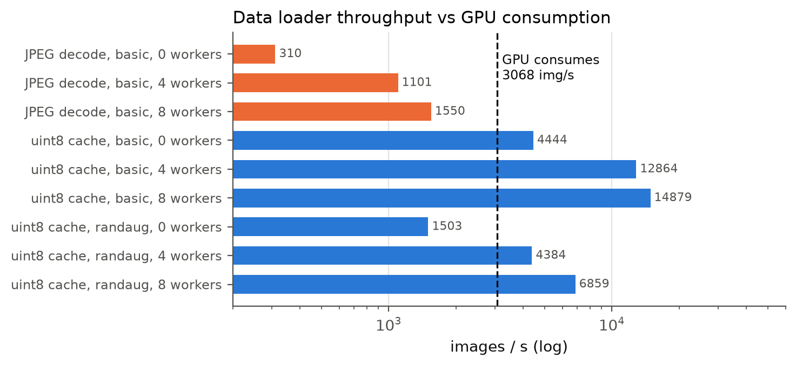
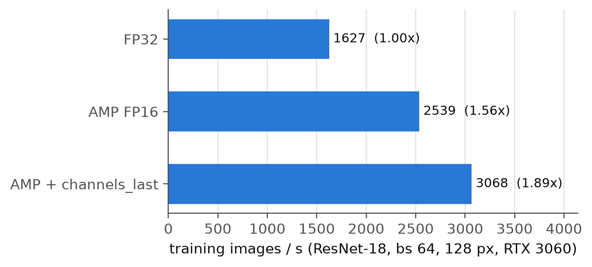

- 每個 batch 都從 JPEG 解碼的話，8 個 workers 最多 **1,550 img/s**，開到 12 個 workers 還是 1,561 img/s，已經飽和。這只有 GPU 處理速度（ResNet-18、AMP + channels_last、bs 64 時 **3,068 img/s**）的一半，所以 data loader 會是瓶頸。
- 改成啟動時一次解碼成 uint8 cache（train + val + test 總共 225 MB）之後，basic augmentation 有 14,879 img/s，開 RandAugment 也有 6,859 img/s（8 workers），都比 GPU 快，loader 不再是瓶頸。normalize 移到 GPU 上做。
- AMP FP16 讓吞吐量變成 FP32 的 **1.56×**，再加 channels_last 變成 **1.89×**（1,627 → 3,068 img/s）。
- 結果：80 epochs 的 ResNet-18 一次約 85 秒，整套實驗（約 100 次訓練）在單張 3060 上幾小時就跑完。

## 2. Learning rate sweep（cosine，basic aug，80 epochs，seed 0）

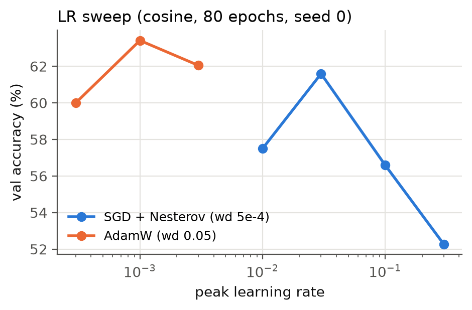

| optimizer | 0.01 | 0.03 | 0.1 | 0.3 |
|---|---|---|---|---|
| SGD + Nesterov（wd 5e-4） | 57.5 | **61.6** | 56.6 | 52.3 |

| optimizer | 3e-4 | 1e-3 | 3e-3 |
|---|---|---|---|
| AdamW（wd 0.05） | 60.0 | **63.4** | 62.0 |

（val accuracy %）下一階段用 SGD 0.03、AdamW 1e-3。這一階段只跑一個 seed，所以只用來找數量級。

## 3. Optimizer × LR schedule（3 seeds）

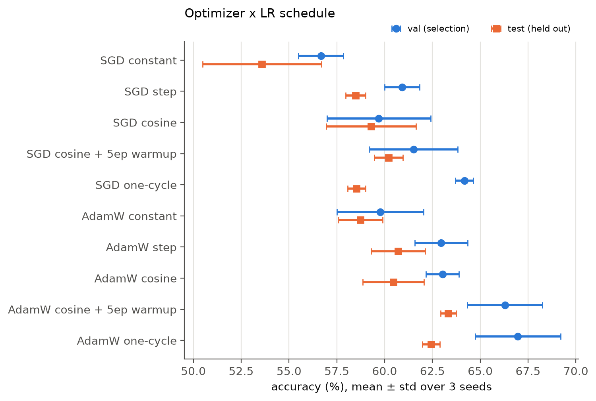
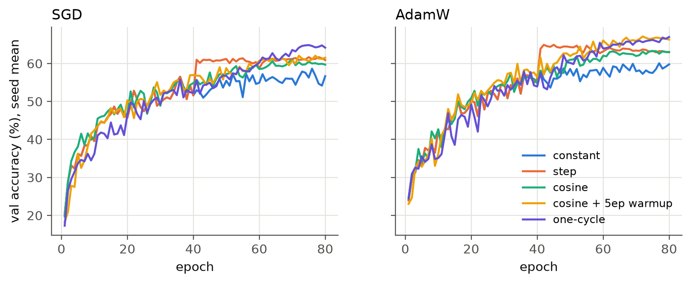

| | val | test |
|---|---|---|
| SGD constant | 56.7 ± 1.2 | 53.6 ± 3.1 |
| SGD step | 60.9 ± 0.9 | 58.5 ± 0.5 |
| SGD cosine | 59.7 ± 2.7 | 59.3 ± 2.4 |
| SGD cosine + 5ep warmup | 61.5 ± 2.3 | 60.2 ± 0.7 |
| SGD one-cycle | 64.2 ± 0.5 | 58.5 ± 0.5 |
| AdamW constant | 59.8 ± 2.3 | 58.7 ± 1.2 |
| AdamW step | 63.0 ± 1.4 | 60.7 ± 1.4 |
| AdamW cosine | 63.0 ± 0.9 | 60.5 ± 1.6 |
| AdamW cosine + 5ep warmup | 66.3 ± 2.0 | **63.3 ± 0.4** |
| **AdamW one-cycle**（val 最高，被選中） | **67.0 ± 2.2** | 62.4 ± 0.5 |

觀察：
- **不衰減 learning rate 一定最差。** 兩種 optimizer 用 constant LR 都排最後。從 curve 看得出來，step schedule 在第 40 epoch 降 LR 時，val accuracy 會往上跳約 8 pt。
- 在這個設定下，五種 schedule 的 AdamW test 都比 SGD 高 1.2–5.1 pt。不過 SGD 的 LR 只掃了 4 個點，這個比較對 SGD 可能不公平。
- 有衰減的幾種 schedule 之間，差距大多在 1–2 個 std 以內。**val 和 test 的排序不一致**：SGD one-cycle 在 val 排 SGD 第一，test 卻和 step 並列最低；AdamW 這邊 val 選了 one-cycle，test 最好的卻是 cosine + warmup。用 440 張 val 選設定，解析度大約只到 ±2 pt。

## 4. Augmentation 逐項加入（AdamW one-cycle，3 seeds）

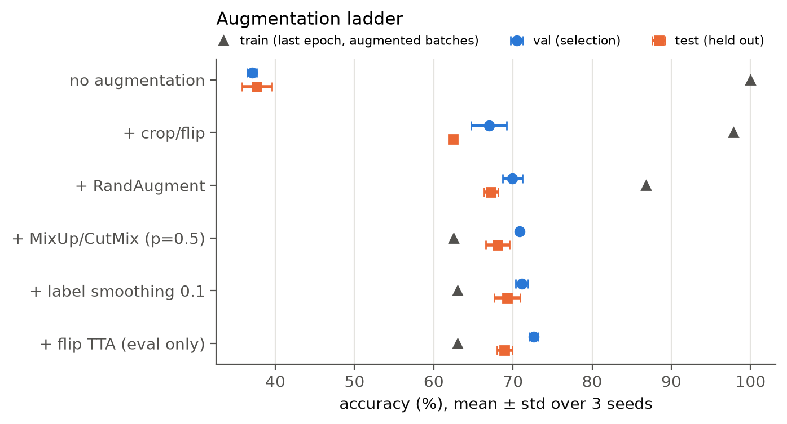

| | val | test | train（最後 epoch） |
|---|---|---|---|
| 不做 augmentation | 37.0 ± 0.6 | 37.7 ± 1.9 | 100.0 |
| + random-resized-crop / flip | 67.0 ± 2.2 | 62.4 ± 0.5 | 97.9 |
| + RandAugment (2, 9) | 69.9 ± 1.3 | 67.2 ± 0.9 | 86.8 |
| + MixUp/CutMix (p = 0.5) | 70.8 ± 0.3 | 68.1 ± 1.5 | 62.5* |
| + label smoothing 0.1 | **71.1 ± 0.8** | **69.2 ± 1.6** | 63.0* |
| + flip TTA（只在評估時） | 72.7 ± 0.6 | 68.9 ± 0.9 | — |

\* train accuracy 是在混合過的 batch 上算的，和前幾列不能直接比。

- 只有 2,640 張圖時，不做 augmentation 會完全記住訓練集（train 100%、test 37.7%）。光加 crop/flip 就讓 test 提高 **24.7 pt**；再加 RandAugment 又提高 **4.8 pt**，而且三個 seed 的 std 都小於這個差距。
- MixUp/CutMix（+0.9）和 label smoothing（+1.1）的方向是正的，但都在 1 個 std 左右，**不能說有顯著效果**。
- Flip TTA 讓 val 提高 1.6 pt，test 卻降了 0.3 pt，所以沒有採用。這又是一個 val 和 test 不一致的例子。
- 整體來看，test 從 37.7% 提高到 69.2%。

## 5. Optuna hyperparameter search

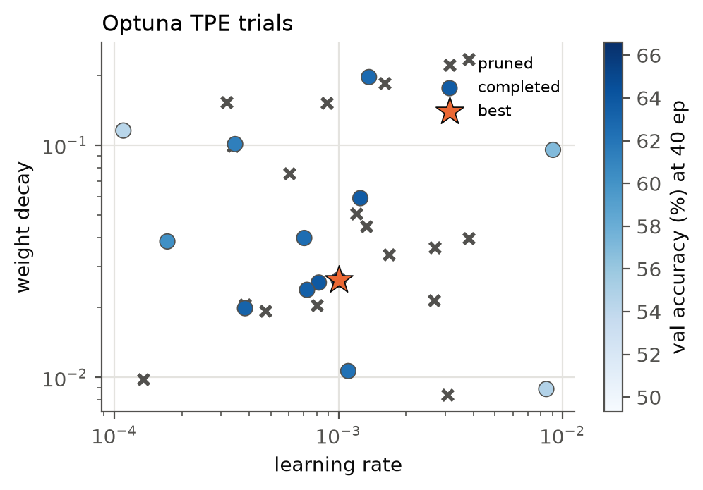
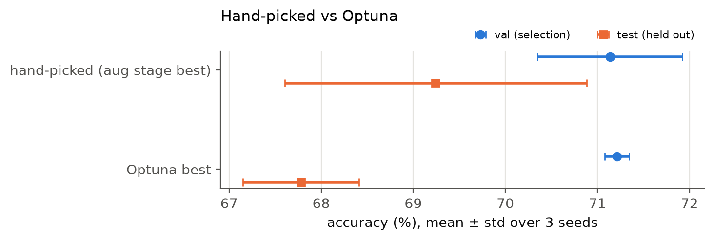

- 搜尋方式：TPE sampler，30 個 trials，每個 trial 跑 40 epochs，用 MedianPruner 提早停掉差的 trial（前 8 個 trial 不 prune，前 15 epoch 不 prune）。只看 val accuracy，test 完全不計算。
- 搜尋空間：lr、weight decay（log scale）、MixUp/CutMix 機率、label smoothing。
- **30 個 trial 有 17 個（57%）被提前停掉**，節省了大約一半的 GPU 時間。
- 最佳參數：lr 1.0e-3、wd 0.026、mix 0.014（等於沒開）、smoothing 0.12。lr 和手選的一樣。

| 80 epochs × 3 seeds | val | test | train |
|---|---|---|---|
| 手選（第 4 節最後一列） | 71.1 ± 0.8 | **69.2 ± 1.6** | 63.0 |
| Optuna 最佳參數 | **71.2 ± 0.1** | 67.8 ± 0.6 | 88.2 |

- 兩者 val 幾乎相同；但 Optuna 的參數 test 低 1.4 pt，train 高 25 pt，也就是 overfit 得更多。
- 可能的解釋是 **short-horizon bias**：只跑 40 epochs 的代理任務，會偏好正則化較弱的設定（MixUp 幾乎關掉），但正式訓練是 80 epochs，這時更強的正則化才有回報。這只是推測，這次沒有另外驗證。
- 依照「只看 val」的規則，後面的實驗用的是 Optuna 參數（只贏 0.1 pt）。事後看，用手選的可能一樣好，甚至更好。

## 6. Knowledge distillation（200 epochs，3 seeds）

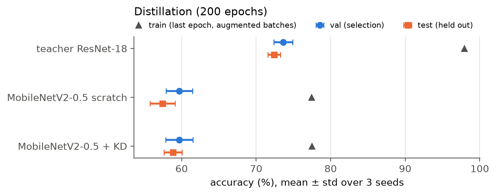
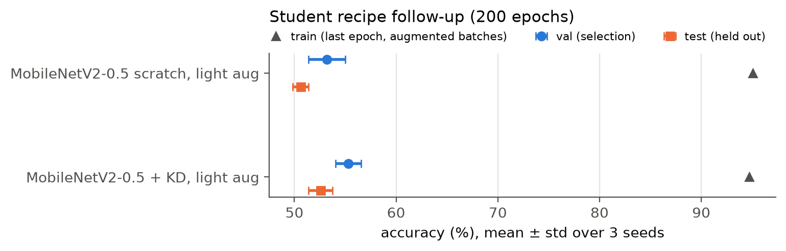

| | params | val | test | train |
|---|---|---|---|---|
| Teacher ResNet-18 | 11.2 M | 73.6 ± 1.3 | **72.4 ± 0.8** | 97.9 |
| MobileNetV2-0.5，從零訓練 | 0.7 M | 59.7 ± 1.8 | 57.4 ± 1.7 | 77.4 |
| MobileNetV2-0.5 + KD（T = 4，α = 0.7） | 0.7 M | 59.7 ± 1.8 | 58.8 ± 1.2 | 77.5 |
| *追加實驗：student 改用較弱的 augmentation（只有 crop/flip，不做 mix 與 smoothing）* | | | | |
| MobileNetV2-0.5，從零訓練，弱 aug | 0.7 M | 53.2 ± 1.8 | 50.6 ± 0.8 | 95.1 |
| MobileNetV2-0.5 + KD，弱 aug | 0.7 M | 55.3 ± 1.3 | 52.6 ± 1.2 | 94.7 |

- 同一套參數，teacher 從 80 epochs 拉長到 200 epochs，test 從 67.8 提高到 72.4。
- student 比 teacher 低約 14 pt。原本懷疑是 teacher 的強正則化讓 student 學不起來（train 只有 77%），所以加跑了追加實驗。**結果推翻了這個假設**：改用弱 augmentation 後 student 反而 overfit（train 95%），test 掉了 6.8 pt。0.7 M 參數的模型在 2,640 張圖上，一樣需要強 augmentation。
- KD 在兩種設定下 test 都比較好（+1.4、+2.0 pt），同一個 seed 互相比較時，6 組中有 5 組 KD 勝出。方向一致，但差距只有 1–2 個 std，算是**小但一致的效果**。
- 尚未測試：teacher 訓練時用了 label smoothing，文獻指出這可能讓 teacher 比較不適合拿來蒸餾（Müller et al., 2019）。這次沒有驗證。

## 7. INT8 quantization（x86 / fbgemm，CPU）

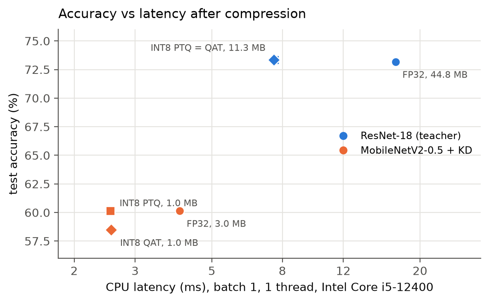

每個模型取 val 最高的那個 seed。PTQ 用 512 張訓練圖做 calibration。QAT 從 FP32 權重開始微調 10 epochs（lr 1e-3、cosine），在一半 epoch 時凍結 BN 統計量，最後 3 epochs 凍結 observer。

| 模型 | 版本 | 大小 | val | test | CPU 1 thread | CPU 4 threads |
|---|---|---|---|---|---|---|
| ResNet-18 | FP32 | 44.8 MB | 74.8 | 73.2 | 16.99 ms | 8.42 ms |
| ResNet-18 | INT8 PTQ | 11.3 MB | 74.8 | 73.3 | **7.60 ms** | 3.96 ms |
| ResNet-18 | INT8 QAT | 11.3 MB | 75.0 | 73.3 | 7.55 ms | 3.65 ms |
| MobileNetV2-0.5 + KD | FP32 | 3.0 MB | 61.8 | 60.2 | 4.04 ms | 4.55 ms |
| MobileNetV2-0.5 + KD | INT8 PTQ | 0.98 MB | 62.5 | 60.2 | **2.55 ms** | 2.21 ms |
| MobileNetV2-0.5 + KD | INT8 QAT | 0.98 MB | 60.5 | 58.5 | 2.55 ms | 2.45 ms |

（batch 1、128 px，取 300 次中位數，測試 CPU 為 i5-12400）

- **ResNet-18 做 PTQ 後，模型小 3.96 倍，單執行緒 latency 快 2.24 倍，accuracy 沒有掉**（test 73.2 → 73.3）。PTQ 已經沒有損失，QAT 就沒有可以補回的空間。
- MobileNetV2-0.5 做 PTQ 後小 3.05 倍、快 1.58 倍，accuracy 一樣沒掉。QAT 反而讓 test 低了 1.7 pt。我的 QAT 微調只用 plain cross-entropy，沒有加 KD 和 label smoothing，等於換掉了原本的訓練目標，這是最可能的原因（未驗證）。
- FP32 的 MobileNetV2 用 4 threads 比 1 thread 慢（4.55 vs 4.04 ms）：batch 1 的小模型，平行化的開銷比它省下的計算時間還多。
- 用 GPU 跑 FP16、batch 1 時，ResNet-18 是 1.70 ms，MobileNetV2-0.5 卻是 3.87 ms，反而比較慢。小 batch 時 GPU 的瓶頸是 kernel launch 次數；MobileNetV2 層數多、depthwise conv 運算量小，所以參數少也沒有比較快。

## 8. 追加：預訓練 backbone（不在作業規定內）

作業規定從零開始訓練，前面七節都照做。這一節追加：如果允許使用預訓練權重，accuracy 能到哪裡。設計在跑之前就固定（見 `scripts/transfer.py` 開頭），split 和第 0 節相同，選擇一樣只看 val。

- **ResNet-18（ImageNet）**：128 px（和從零訓練相同的輸入）與 224 px 各跑一次，lr {3e-4, 1e-3, 3e-3}、30 epochs，用 seed 0 的 val 選 lr，再跑 3 個 seed。
- **CLIP ViT-B/16**：
  - zero-shot：prompt 是「a photo of {類別}, a type of food.」。
  - linear probe：只訓練最後的線性層，weight decay 用 val 選。
  - 完整 fine-tune：分類頭用 zero-shot 的文字向量初始化，lr {5e-6, 1e-5, 3e-5}、10 epochs，選法同上。
- **Pseudo-labeling**：val 最好的模型（CLIP fine-tune）幫 6,786 張無標籤圖片標註（flip TTA），信心度 ≥ 0.9 的留下，和 train 合併後用同樣設定重訓 3 個 seed。

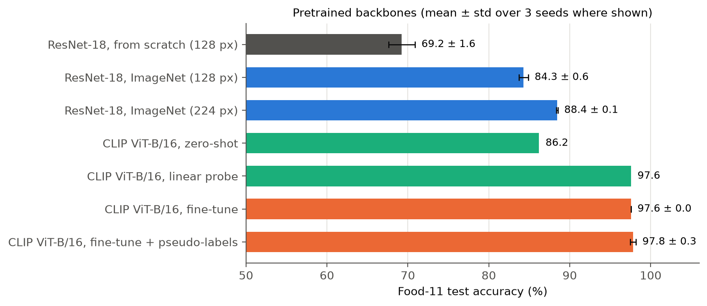

| test（660 張） | accuracy | 訓練時間 / run |
|---|---|---|
| ResNet-18 從零訓練（第 4 節最佳） | 69.2 ± 1.6 | — |
| ResNet-18 ImageNet，128 px，lr 3e-4 | 84.3 ± 0.6 | 47 s |
| ResNet-18 ImageNet，224 px，lr 3e-4 | 88.4 ± 0.1 | 110 s |
| CLIP zero-shot | 86.2 | — |
| CLIP linear probe | 97.6 | — |
| CLIP fine-tune，lr 5e-6 | 97.6 ± 0.0 | 239 s |
| CLIP fine-tune + pseudo-labels | 97.8 ± 0.3 | — |

**觀察**

1. **預訓練帶來的提升遠大於前面所有調整。** 同樣是 128 px 的 ResNet-18，換成 ImageNet 權重就從 69.2% 升到 84.3%，比第 4 節所有 augmentation 加起來還多。改成 224 px 再多 4 pt。
2. **CLIP 不訓練就有 86.2%**，已經贏過 128 px 的 ImageNet ResNet-18。
3. **完整 fine-tune 沒有贏過 linear probe**，兩者都是 97.6%（test 一張圖等於 0.15 pt）。CLIP 的特徵本身就足以分開這 11 類，多訓練 backbone 只是多花時間。
4. **Pseudo-labeling 在雜訊範圍內**：97.8 ± 0.3 對 97.6 ± 0.0。差距大約一張圖。

**要注意的地方**

- **ResNet 選中的 lr 3e-4 在搜尋範圍的邊界**，更小的 lr 可能更好。CLIP 的 5e-6 也在邊界。這裡沒有再往外延伸。
- **Pseudo-label 只留了 3,580 / 6,786 張（53%）。** 原因是 teacher 用 label smoothing 0.1 訓練，11 類時最高信心度約 0.91，所以 0.9 的門檻幾乎就在上限，信心度的中位數也正好是 0.90。門檻是事先定的，沒有事後調整。
- **「rice」一張 pseudo-label 都沒有。** teacher 在 6,786 張中只把 6 張預測為 rice，最高信心度 0.72。無標籤資料沒有標註，所以無法判斷是資料裡本來就很少 rice，還是 teacher 對這類有偏差。
- val 只有 440 張，CLIP 的幾組設定在 val 上相差 1–2 張圖，用來選擇時分辨力有限。

## 9. 追加：超參數逐項研究（ResNet-18 + SiLU）

前面各節的 ResNet-18 都用 ReLU。這一節是事後追加的：把 activation 全部換成 SiLU，每次只改一個超參數，其他維持參考設定，看每個旋鈕單獨的效果。組別和數值在跑之前就定好，每列都是 3 個 seed、80 epochs，全部列出，沒有從這裡挑設定回去用。

- 參考設定（ref）：AdamW lr 1e-3、weight decay 0.05、one-cycle（前 25% warmup，之後 cosine annealing 到接近 0）、RandAugment + MixUp/CutMix 0.5 + label smoothing 0.1、linear head、不加 dropout。
- momentum 這組用 SGD（lr 0.03、wd 5e-4、cosine、只有 crop/flip），因為 AdamW 沒有 momentum 這個旋鈕。

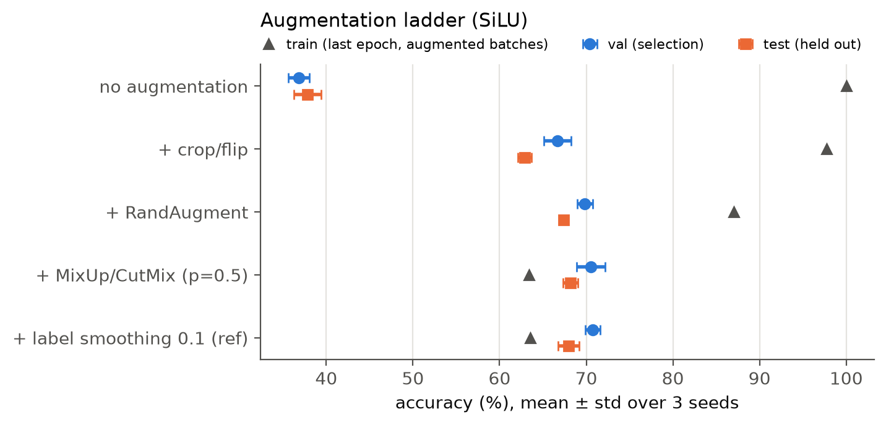

Augmentation 逐項加入（SiLU）：

| | val | test | train |
|---|---|---|---|
| 不做 augmentation | 36.8 ± 1.2 | 37.8 ± 1.6 | 100.0 |
| + crop / flip | 66.7 ± 1.5 | 62.9 ± 0.8 | 97.8 |
| + RandAugment | 69.8 ± 0.9 | 67.4 ± 0.5 | 87.0 |
| + MixUp/CutMix (p = 0.5) | 70.5 ± 1.7 | 68.2 ± 0.8 | 63.4* |
| + label smoothing 0.1（ref） | 70.8 ± 0.9 | 68.0 ± 1.2 | 63.5* |

和第 4 節的 ReLU 版幾乎一樣：crop/flip +25.1 pt、RandAugment +4.5 pt；MixUp/CutMix 和 label smoothing 仍在雜訊範圍內。

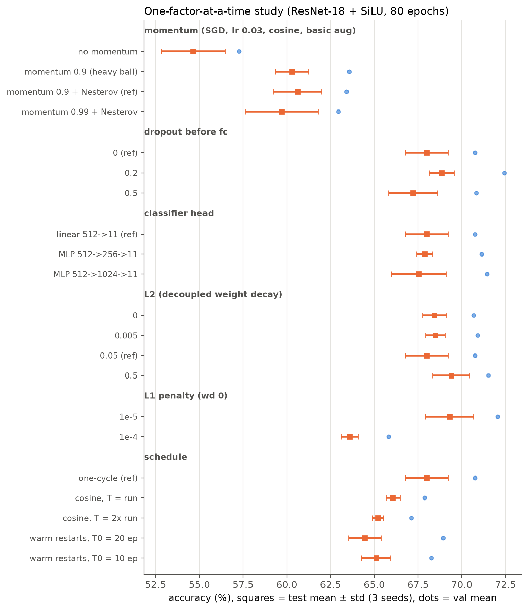

| 組別 | 設定（test mean ± std） | 結論 |
|---|---|---|
| momentum（SGD） | 0：54.6 ± 1.8；0.9：60.3 ± 0.9；0.9 Nesterov：60.6 ± 1.4；0.99 Nesterov：59.7 ± 2.1 | 加 momentum +5.7 pt，是這一節最大的效果。Nesterov 和 heavy ball 分不出來；0.99 沒有更好 |
| dropout（fc 前） | 0：68.0 ± 1.2；0.2：68.8 ± 0.7；0.5：67.2 ± 1.4 | 差距都在 1 個 std 內。augmentation 已經很強，dropout 沒有明顯作用 |
| classifier head | linear：68.0 ± 1.2；MLP 256：67.9 ± 0.5；MLP 1024：67.5 ± 1.6 | 多一層 hidden layer 沒有幫助 |
| L2（AdamW decoupled wd） | 0：68.4 ± 0.7；0.005：68.5 ± 0.5；0.05：68.0 ± 1.2；0.5：69.4 ± 1.0 | 0 到 0.5 差距約 1 個 std；wd 0.5 最高，但不顯著 |
| L1（wd 0） | 1e-5：69.3 ± 1.4；1e-4：63.6 ± 0.5 | 1e-5 和不加差不多；1e-4 太強，train 只剩 50%，test 掉 4.8 pt |
| schedule（AdamW） | one-cycle：68.0 ± 1.2；cosine T = run：66.1 ± 0.4；cosine T = 2 × run：65.2 ± 0.3；warm restarts T0 = 20：64.4 ± 0.9；T0 = 10：65.1 ± 0.8 | 見下 |

Schedule 的觀察：
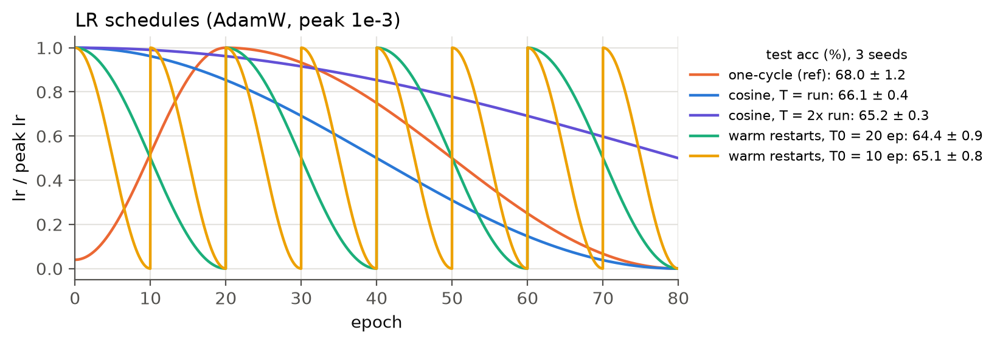

- one-cycle 和 cosine 都用 cosine annealing 退火到接近 0。one-cycle 多了前 25% 的 warmup，而且 PyTorch 的 `OneCycleLR` 預設會讓 AdamW 的 β1 在 0.95 和 0.85 之間反向調整。換成純 cosine，test 低 1.9 pt；這次沒有拆開 warmup 和 β1 各自的貢獻。
- T = 2 × run 表示 cosine 只走到一半，最後 lr 還有峰值的一半。沒有退火到底，test 再低 0.9 pt。
- Warm restarts 每 T0 個 epoch 把 lr 拉回峰值。80 epochs 下兩種 T0 都比單一 cosine 低 1–1.7 pt。

小結：在 2,640 張的資料上，影響最大的是 augmentation 和 momentum；schedule 上 one-cycle 最好，cosine 沒有退火到底或中途 restart 都會再低 1–2 pt；dropout、hidden layer、L2 的強度在 3 個 seed 的雜訊內分不出來；L1 太強會明顯 underfit。

## 10. 結論

1. **最有效的是 augmentation**：test 從 37.7% 提高到 69.2%。其中 crop/flip 加 RandAugment 貢獻 29.5 pt；MixUp/CutMix 和 label smoothing 方向正確，但在雜訊範圍內。
2. **LR 一定要衰減**；在 decayed schedule 之間，差距小於 440 張 val 能分辨的程度。
3. **自動化 HPO 不一定贏過人工設定**：40-epoch 代理任務選出的設定，在 80 epochs 時 test 低了 1.4 pt。
4. **ResNet-18 INT8 PTQ 沒有掉 accuracy**：模型小 4 倍、CPU 快 2.2 倍。QAT 只有在 PTQ 有損失時才值得做。
5. **工程面**：先解碼成 uint8 cache，加上 AMP 和 channels_last，讓 GPU 不再等資料，訓練吞吐量是 FP32 的 1.89 倍。
6. **逐項調超參數（SiLU）**：momentum +5.7 pt、one-cycle 比純 cosine +1.9 pt；dropout、hidden layer、L2 在雜訊內，L1 1e-4 掉 4.8 pt。
7. **如果允許預訓練權重**：ImageNet ResNet-18 到 88.4%，CLIP linear probe 到 97.6%。完整 fine-tune 和 pseudo-labeling 都沒有再明顯往上。

## 重現

```bash
cd ~/food11-pipeline
uv sync
uv run python -m f11.data                        # 解碼並建立 uint8 cache
uv run python scripts/profile_pipeline.py
uv run python scripts/experiments.py             # lr sched aug hpo distill quant
uv run python scripts/experiments.py distill_light
uv run python scripts/transfer.py                # 第 8 節：clip sweep seeds pseudo
uv run python scripts/experiments.py hparams     # 第 9 節
uv run python scripts/make_figs.py
```

所有數字都來自 `runs/summary_*.json` 、`runs/profile.json` 和 `runs/transfer/summary.json`；每次訓練的逐 epoch 紀錄存在 `runs/<name>/result.json`。
